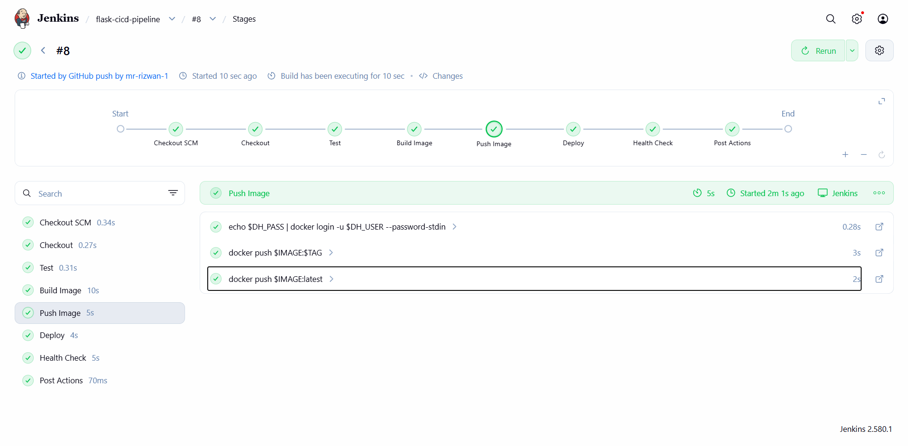
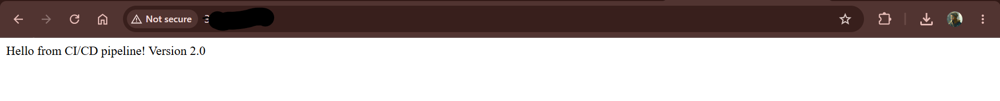
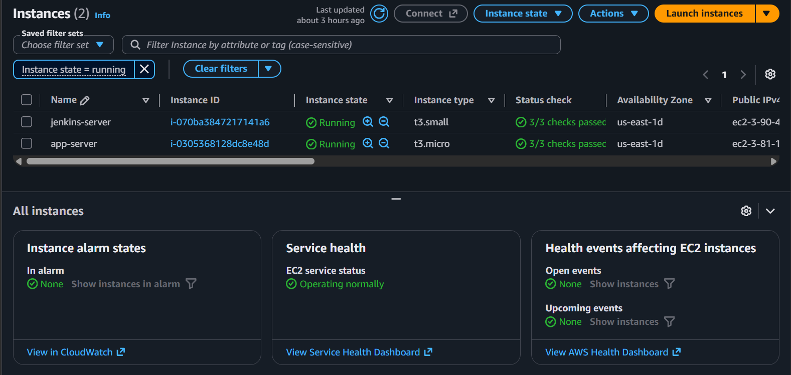
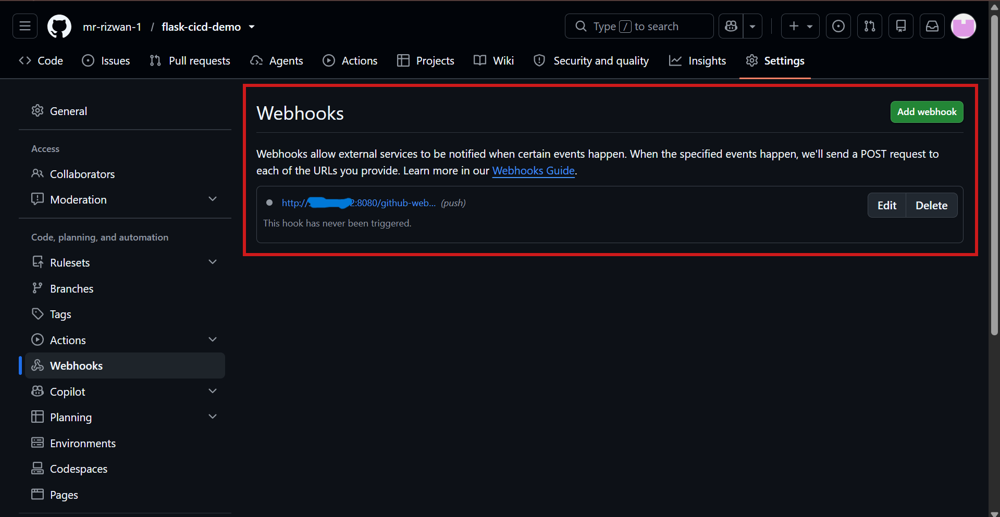
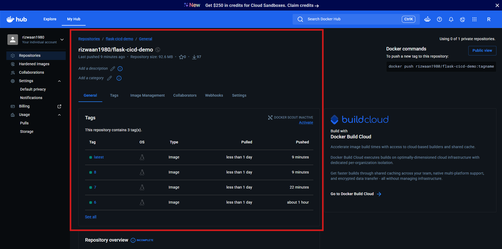

# Flask CI/CD Pipeline: Jenkins + Docker + AWS EC2

Automated pipeline: a GitHub push triggers Jenkins, which builds a Docker image,
pushes it to Docker Hub, and deploys it to an AWS EC2 server.

## Tech Stack
Jenkins | Docker | GitHub Webhooks | AWS EC2 | Bash | Flask

## Architecture

```
Developer git push
      ↓
GitHub Webhook ──► Jenkins (EC2 #1)
                      ↓
        Checkout → Test → Docker Build → Push to Docker Hub
                      ↓
              SSH into App Server (EC2 #2)
                      ↓
        docker pull → stop old container → run new container
                      ↓
              Health check (curl) ✅
```

## Pipeline Stages
Checkout → Test → Build Image → Push Image → Deploy → Health Check

## AWS Security Groups

| Server  | Port | Source                      |
|---------|------|-----------------------------|
| Jenkins | 22   | My IP                       |
| Jenkins | 8080 | 0.0.0.0/0 (GitHub webhook)  |
| App     | 22   | Jenkins server SG           |
| App     | 80   | 0.0.0.0/0                   |

## Rollback
Every image is tagged with the Jenkins build number, so any previous version
can be redeployed:

```bash
docker run -d --name flask-app -p 80:5000 <dockerhub-user>/flask-cicd-demo:<build_number>
```

## Screenshots








